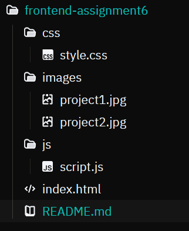
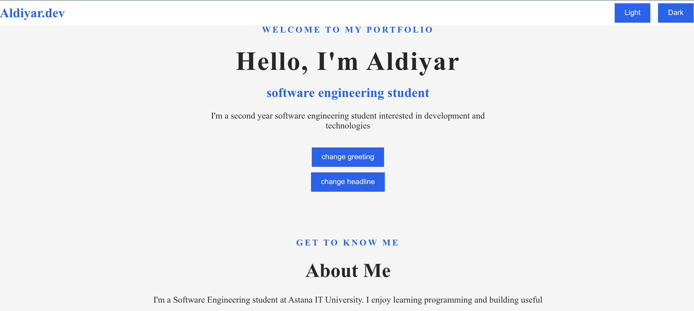
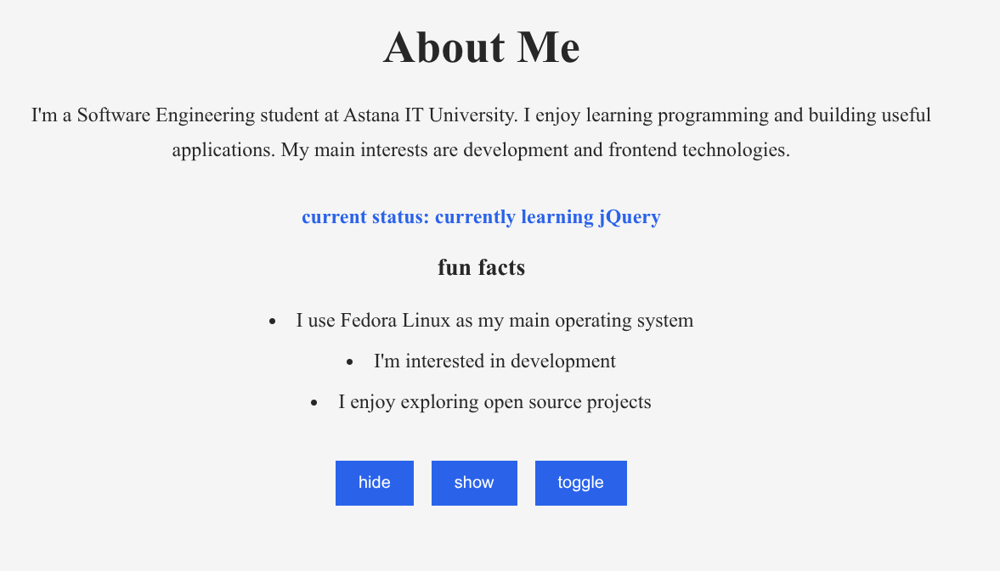
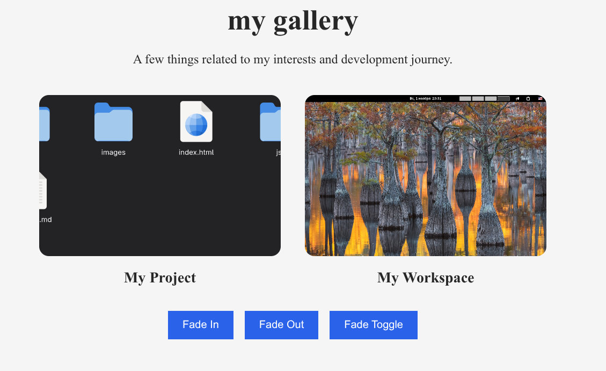
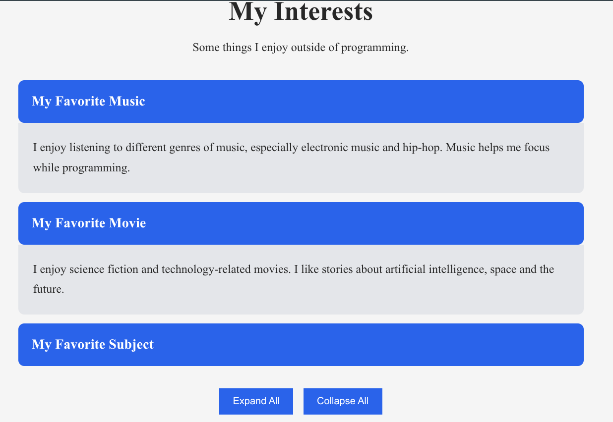
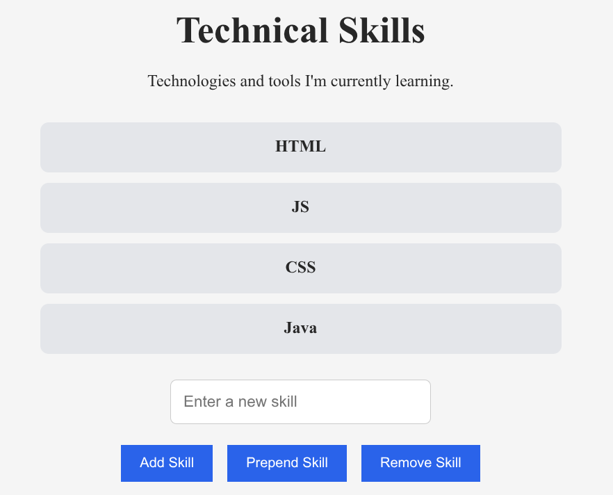
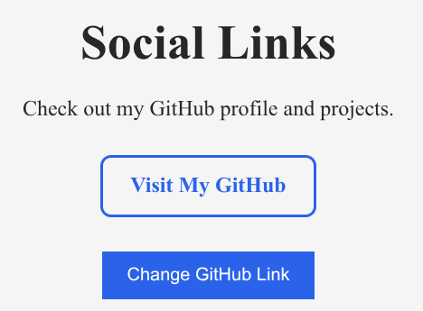
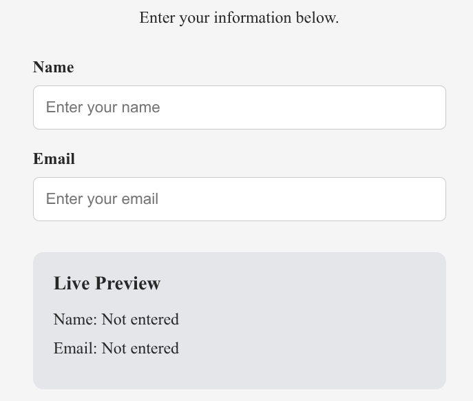
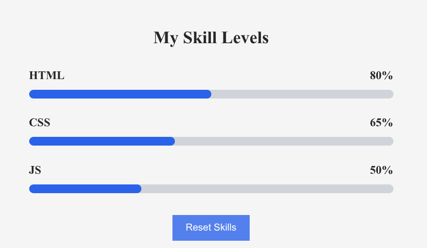

# Assignment 6 - jQuery
## Aldiyar Kairollin | SE-2539

## Overview

This project is a personal developer portfolio website created as part of Frontend Assignment 6.

The main purpose of this assignment is to practice jQuery and DOM manipulation by implementing interactive elements, effects, form interactions, and animations.

## Implemented Tasks

### Task 0 - Project Setup

Created the initial project structure and configured HTML, CSS, JavaScript, and jQuery.

### Task 1 - jQuery Selectors and CSS Manipulation

Used jQuery selectors to select HTML elements and modify their CSS properties.

Implemented:
- Element selectors
- ID selectors
- Class selectors
- CSS manipulation
- Text and HTML modification

### Task 2 - Visibility Methods

Implemented jQuery visibility methods:

- `.hide()`
- `.show()`
- `.toggle()`

Added buttons to control the visibility of the About section.

### Task 3 - Fade Methods

Implemented fade effects for images using:

- `.fadeIn()`
- `.fadeOut()`
- `.fadeToggle()`

Added interactive controls to the image gallery.

### Task 4 - Slide Methods

Implemented sliding effects for expandable content:

- `.slideUp()`
- `.slideDown()`
- `.slideToggle()`

Created interactive panels for displaying personal interests.

### Task 5 - Adding and Removing Elements

Implemented dynamic DOM manipulation:

- `.append()`
- `.prepend()`
- `.remove()`

Created an interactive technical skills list.

### Task 6 - Modifying Attributes

Used `.attr()` to dynamically change the `href` attribute of a GitHub link.

### Task 7 - Form Interaction

Created a contact form with real-time input preview.

Implemented:
- `.val()` to retrieve input values
- `.text()` to update displayed content
- `input` event handling

### Task 8 - Basic Animation

Implemented animated skill progress bars using:

- `.animate()`
- `.each()`
- `.stop()`

Added a button to animate and reset skill progress bars.

